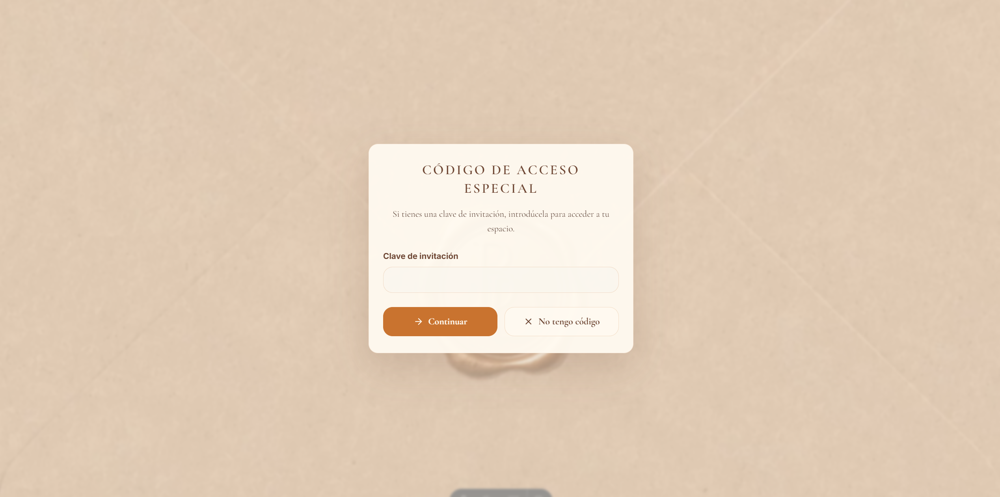
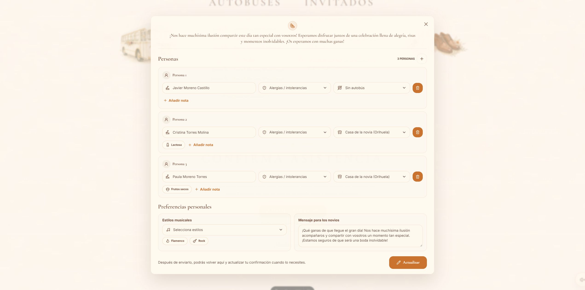
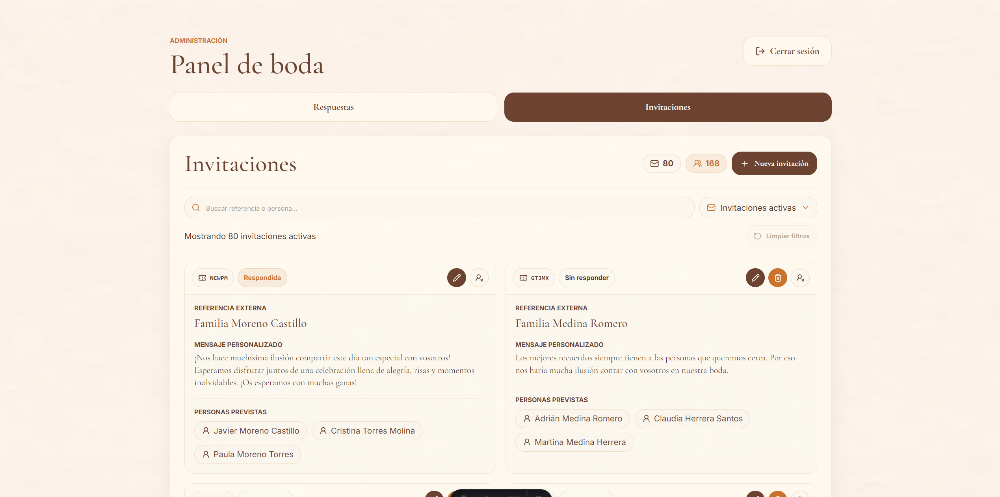
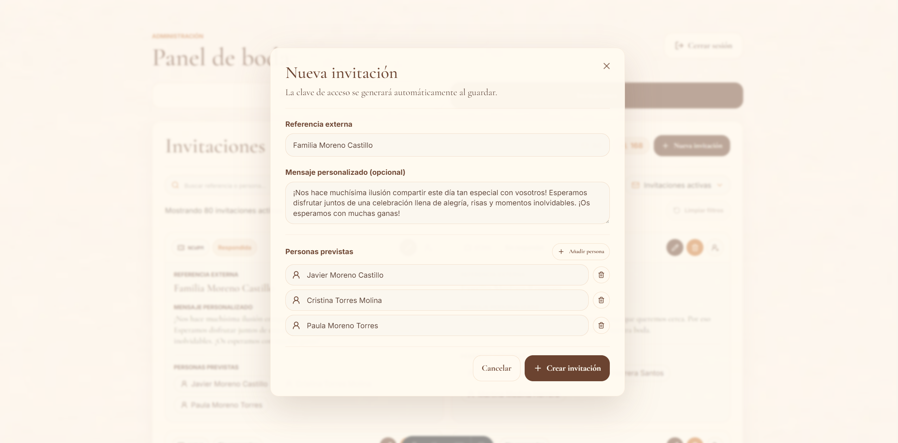
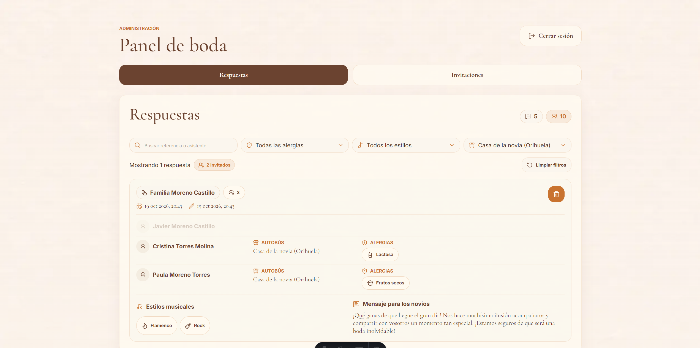

## Una invitación que también organiza

La boda de mi hermana, Belén, y David dio origen a este proyecto: una web que combina el carácter personal de una invitación con una herramienta para organizar a los invitados.

El reto era reunir la información de la celebración y las confirmaciones en un mismo lugar. Gestionar todo mediante conversaciones separadas dificulta saber quién asistirá o qué necesita cada persona, especialmente cuando las invitaciones corresponden a parejas o familias.

## Acceso con código de invitación

Cada grupo recibe un código que identifica su invitación. Puede acceder mediante un **enlace personalizado que incorpora el código** o introducirlo en el **modal de acceso** de la web. Ambas opciones permiten reconocer la misma invitación sin crear una cuenta.

<figure>

<figcaption>Acceso a la invitación mediante el código compartido con cada grupo.</figcaption>
</figure>

Una vez validado el código, la web muestra el mensaje personalizado de la invitación y permite gestionar su confirmación. La sesión conserva ese contexto para las visitas posteriores. La información general de la celebración se puede consultar sin código.

## Confirmación de asistencia

El formulario permite confirmar la asistencia de parejas y familias en una misma respuesta. Parte de los nombres previstos en la invitación y permite añadir o quitar integrantes y completar el transporte y las necesidades alimentarias de cada persona.

<figure>

<figcaption>Confirmación de un grupo con las necesidades de cada persona y las preferencias compartidas.</figcaption>
</figure>

La confirmación se puede recuperar y actualizar mientras el plazo esté abierto, manteniendo una única respuesta por invitación. Los cambios se guardan sin recargar la página y el formulario comunica el estado del envío.

## Panel de administración

El panel privado ofrece a la pareja una visión general de los invitados y sus necesidades. Se divide en **gestión de invitaciones** y **consulta de respuestas**, separando los grupos previstos de las personas que han confirmado su asistencia.

### Gestión de invitaciones

Desde esta vista se preparan los grupos que recibirán la invitación, se personaliza su mensaje y se obtiene el enlace asociado a su código de acceso. El listado muestra el estado de respuesta y permite localizar los pendientes mediante búsquedas y filtros. Los recuentos ofrecen una visión conjunta de las invitaciones activas y las personas previstas.

También permite marcar los grupos que finalmente no asistirán y reactivarlos si cambian de planes, conservando sus datos y ajustando los recuentos.

<figure>

<figcaption>Vista de invitaciones con el estado de respuesta de cada grupo y los recuentos de la organización.</figcaption>
</figure>

La creación y edición se realizan en un diálogo que reúne los datos del grupo. Esto permite mantener el contexto del listado mientras se prepara una invitación o se ajustan sus integrantes.

<figure>

<figcaption>Creación de una invitación con un mensaje personalizado y las personas que forman el grupo.</figcaption>
</figure>

### Consulta de respuestas

Esta vista reúne las confirmaciones por invitación, con los datos de cada asistente. La búsqueda, los filtros y los recuentos permiten consultar las necesidades de transporte y alimentación para preparar el autobús o el catering.

La interfaz destaca a las personas que coinciden con los filtros y atenúa al resto, manteniendo visible el contexto de su grupo. Así, la pareja puede pasar de una visión general de la asistencia a la información que necesita para una tarea concreta.

<figure>

<figcaption>Consulta de respuestas por transporte, con las personas que coinciden con el filtro destacadas dentro de su grupo.</figcaption>
</figure>

## Una arquitectura ajustada al proyecto

**Astro y React comparten una aplicación Node.js con TypeScript.** Astro prepara el contenido en el servidor y React aporta interactividad a los formularios y al panel. Esta distribución permite reservar la hidratación para los componentes que necesitan gestionar estado, sin convertir toda la web en una aplicación de cliente.

La lógica de negocio se separa de la interfaz mediante servicios de aplicación. Las sesiones de invitados y administración son independientes, y los permisos y las reglas de confirmación se comprueban en el servidor.

SQLite encaja con el alcance del proyecto porque ofrece persistencia relacional sin mantener un servidor de base de datos adicional. Permite guardar las confirmaciones de un grupo de forma consistente mediante transacciones y mantener una aplicación sencilla de operar.

## Identidad visual y rendimiento

La invitación animada aporta el carácter personal de la experiencia: un sobre se abre para presentar una carta con el mensaje de la pareja, personalizado para cada grupo cuando se ha definido.

La paleta combina fondos crema, marrones y acentos anaranjados para dar continuidad a la estética de la invitación. El mismo lenguaje visual se mantiene en el formulario y en el panel, adaptado a interfaces donde la lectura y la organización de la información tienen más peso.

Colores, tipografías, espaciados y acabados se centralizan en un tema compartido con Tailwind CSS y componentes reutilizables. Esto mantiene la coherencia entre las secciones de la web y los formularios, y facilita adaptar el diseño a distintas pantallas.

Las imágenes tienen un peso importante en la experiencia. Un componente compartido utiliza **Astro y Sharp para generar variantes en distintos tamaños y formatos AVIF y WebP**. Mediante `srcset` y `sizes`, el navegador elige la variante adecuada al espacio disponible y a la densidad de la pantalla, evitando descargar siempre la imagen original.

La infraestructura de despliegue incorpora una **caché de imágenes en Nginx** que reutiliza las variantes generadas entre visitas, evitando que Astro y Sharp repitan la misma transformación en cada petición. La caché HTTP permite además que el navegador reutilice las imágenes ya descargadas mientras sigan vigentes.

## Tecnologías y librerías

| Tecnología                 | Uso en el proyecto                                                       |
| -------------------------- | ------------------------------------------------------------------------ |
| **Astro**                  | Páginas, renderizado en servidor y acciones de la aplicación.            |
| **React**                  | Formulario de asistencia y panel de administración interactivos.         |
| **TypeScript**             | Tipado de componentes, servicios y datos de la aplicación.               |
| **Node.js y SQLite**       | Ejecución del servidor y persistencia de invitaciones y respuestas.      |
| **Tailwind CSS**           | Diseño adaptable y estilos basados en un tema compartido.                |
| **Sharp y `astro:assets`** | Generación y entrega de imágenes en distintos tamaños y formatos.        |
| **Embla Carousel**         | Carruseles de fotografías y contenido de la web.                         |
| **Lucide**                 | Iconografía compartida entre componentes Astro y React.                  |
| **Zod**                    | Validación de datos de entrada en acciones del servidor.                 |
| **Docker y Compose**       | Empaquetado y ejecución de la aplicación con almacenamiento persistente. |
| **Nginx**                  | Proxy inverso y caché de imágenes en la infraestructura de despliegue.   |
