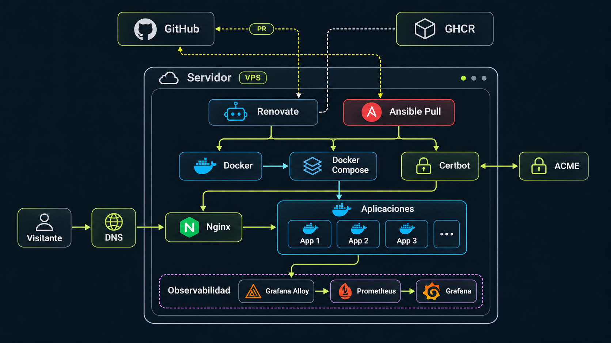

## Reproducible infrastructure

Cloud Platform starts with a concrete need: being able to replace a server, reinstall it or recover from a problem and deploy my services again from a known configuration. I want infrastructure I can rebuild and understand without relying on remembering every adjustment I made to a machine.

The platform follows GitOps principles: the infrastructure is described declaratively in Git, which acts as the source of truth. Rather than relying on a deployment initiated from outside, the server periodically retrieves the configuration using Ansible Pull and reconciles its actual state with the desired state. Git makes it possible to review changes and retain their history.

The platform separates service configuration from the provider hosting the infrastructure. It can move between compatible environments without tying the project to a particular cloud provider. Each application keeps its own configuration, while the platform handles shared tasks for running services, publishing them and managing certificates.

## Architecture

The architecture separates infrastructure reconciliation, application traffic and observability. Each tool has a specific responsibility.

- **Ansible Pull** runs periodic reconciliation on the server, retrieving and applying the state defined in Git.
- **Docker** runs applications in containers.
- **Docker Compose** describes each application's images, networks and services.
- **Nginx** receives visits and routes them to the appropriate application according to the domain.
- **Certbot** automates HTTPS certificate issuance and renewal.
- **Renovate** proposes application image updates through pull requests.
- **Grafana Alloy, Prometheus and Grafana** collect, store and visualise infrastructure and application metrics.

<figure>

<figcaption>Initial provisioning and application publishing over HTTPS. Once provisioned, reconciliation runs on the server itself.</figcaption>
</figure>

A container image is the package used to distribute an application. Cloud Platform downloads images already published to GitHub Container Registry (GHCR). Building the code belongs to each application's repository. This separation allows a service to be updated without combining its development with infrastructure configuration.

## Request path

<ol class="case-study-flow" aria-label="Request path">
  <li><strong>Visitor</strong>HTTPS request</li>
  <li><strong>Nginx</strong>Certificate and domain</li>
  <li><strong>Docker network</strong>Internal communication</li>
  <li><strong>Application</strong>Service response</li>
</ol>

The Domain Name System (DNS) directs the domain to the server. There, Nginx receives requests and redirects HTTP traffic to HTTPS, establishing an encrypted connection with the visitor using the domain's certificate.

It then forwards the request to the appropriate container through an internal Docker network. The application receives traffic through the proxy without having to expose its port directly to the outside. This centralises service publication and certificate management.

## Declarative deployment and reconciliation

The repository describes the **desired state**: which applications should run and with what configuration. A systemd timer periodically starts Ansible Pull on the server, which fetches the repository and applies the full infrastructure configuration, even when Git has not changed.

<ol class="case-study-flow" aria-label="Reconciliation cycle">
  <li><strong>Git</strong>Desired state</li>
  <li><strong>Systemd timer</strong>Periodic execution</li>
  <li><strong>Ansible Pull</strong>Fetch and reconcile</li>
  <li><strong>Server</strong>Apply required changes</li>
</ol>

Ansible checks server compatibility and reconciles the infrastructure in stages:

1. **Docker:** installs the container tools and prepares the required networks.
2. **Certificates:** configures Certbot and manages certificates for automated domains.
3. **Applications:** discovers their definitions, downloads images and applies each Docker Compose project.
4. **Nginx:** generates and validates domain configurations and applies changes to the shared proxy.
5. **Observability:** configures the metrics collection, storage and dashboards for the server and its applications.

This order resolves dependencies: applications need the container environment, and Nginx needs certificates and the configuration of the services it will publish.

Each cycle checks the declared configuration and applies the differences detected by Ansible and Docker Compose. This also helps correct configuration drift without requiring a new commit.

## Version control

Application images combine a readable version with a digest calculated using SHA-256. A reference looks like `application:v1.2.3@sha256:…`: the tag communicates the version, and the digest identifies the requested content.

This makes an update reviewable in Git and specifies which image should run, even if a registry tag is moved later.

- **Version (`v1.2.3`):** identifies the published version for the person reviewing the change.
- **Digest (`sha256:…`):** identifies the content Docker should download.

Pinning by digest precisely identifies application images. Reproducing the entire environment also depends on the versions of the tools and packages that make it up.

## Application updates with Renovate

Renovate runs every few minutes and checks for new image versions of the deployed applications. When it detects a new version, it automatically opens a pull request in the infrastructure repository with the changes needed in the Docker Compose definition to use the new image, updating both its version and digest.

Once the pull request has been reviewed and merged, Ansible Pull retrieves the new configuration during its next reconciliation and updates the application. This automates version discovery and update proposals while keeping approval of changes manual.

## HTTPS certificates

To provide HTTPS, the server needs a certificate that establishes its identity for the domain. Certbot requests it through the Automatic Certificate Management Environment (ACME) protocol and uses DNS validation to demonstrate control of that domain.

DNS validation allows certificates for the domains to be obtained before Nginx starts. Publishing a service still requires its DNS record and proxy configuration.

For domains managed through ACME, the automation requests certificates and enables periodic renewal independently of application deployments. The proxy uses certificates in read-only mode. A reload allows Nginx to use renewed certificates.

Certificate management also requires coordinating changes in coverage: adding domains to the configuration must be accompanied by issuing or updating the corresponding certificate.

## Observability

To understand what is happening across the infrastructure, the platform includes a monitoring stack managed alongside the applications. Grafana Alloy collects metrics, Prometheus stores time series and their history, and Grafana presents the information in two dashboards.

| Dashboard      | What it monitors                                               |
| -------------- | -------------------------------------------------------------- |
| Infrastructure | Server performance and resource usage, such as CPU and memory. |
| Applications   | Resource usage, traffic and availability of each application.  |

This separation makes it possible to analyse the overall behaviour of the server and each application independently. The dashboards and metrics collection configuration are versioned alongside the rest of the infrastructure.

## Adding applications

Each application brings together its manifest, its Docker Compose definition and, when it needs public access, an Nginx template. Ansible discovers those definitions in the repository without requiring each project to be added to a central task list.

| Configuration             | Responsibility                                              |
| ------------------------- | ----------------------------------------------------------- |
| Application manifest      | Describes how the application integrates with the platform. |
| Docker Compose definition | Defines the application's runtime environment.              |
| Nginx template            | Configures public access to the service.                    |

This structure separates each project's configuration from the platform's shared tasks. An application can deploy internal services without generating a public route in Nginx.

Each Docker Compose project can group multiple services. If an application needs a database, it can define its own network for it and connect the request-handling service to the proxy.
