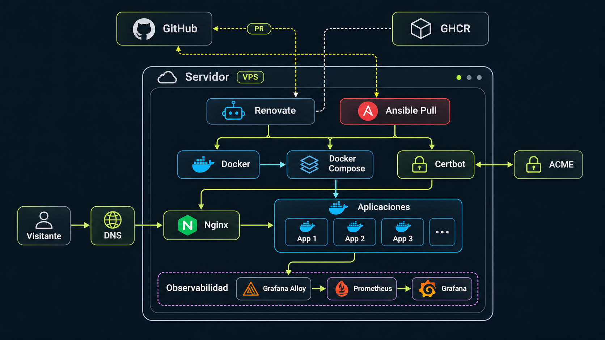

## Infraestructura reproducible

Cloud Platform nace de una necesidad concreta: poder cambiar de servidor, formatearlo o recuperarme de un problema y volver a desplegar mis servicios desde una configuración conocida. Quiero que la infraestructura sea algo que puedo reconstruir y entender, sin depender de recordar cada ajuste que hice en una máquina.

La plataforma sigue los principios de GitOps: la infraestructura se describe de forma declarativa en Git, que actúa como fuente de verdad. En lugar de depender de un despliegue iniciado desde fuera, el propio servidor obtiene periódicamente la configuración mediante Ansible Pull y reconcilia su estado real con el estado deseado. Git permite revisar los cambios y conservar su historial.

La plataforma separa la configuración de los servicios del proveedor que aloja la infraestructura. Puede trasladarse entre entornos compatibles sin vincular el proyecto a un proveedor cloud concreto. Cada aplicación conserva su propia configuración, mientras la plataforma resuelve las tareas compartidas de ejecución, publicación y gestión de certificados.

## Arquitectura

La arquitectura separa la reconciliación de la infraestructura, el tráfico de las aplicaciones y la observabilidad. Cada herramienta tiene una responsabilidad concreta.

- **Ansible Pull** ejecuta la reconciliación periódica en el servidor, obteniendo y aplicando el estado definido en Git.
- **Docker** ejecuta las aplicaciones en contenedores.
- **Docker Compose** describe las imágenes, redes y servicios de cada aplicación.
- **Nginx** recibe las visitas y las dirige a la aplicación correspondiente según el dominio.
- **Certbot** automatiza la emisión y renovación de certificados HTTPS.
- **Renovate** propone actualizaciones de las imágenes de las aplicaciones mediante pull requests.
- **Grafana Alloy, Prometheus y Grafana** recopilan, almacenan y visualizan métricas de la infraestructura y las aplicaciones.

<figure>

<figcaption>Aprovisionamiento inicial y publicación de aplicaciones con HTTPS. Una vez aprovisionado, el propio servidor ejecuta la reconciliación.</figcaption>
</figure>

Una imagen de contenedor es el paquete con el que se distribuye una aplicación. Cloud Platform descarga imágenes ya publicadas en GitHub Container Registry (GHCR). La construcción del código pertenece al repositorio de cada aplicación. Esta separación permite actualizar un servicio sin mezclar su desarrollo con la configuración de la infraestructura.

## Recorrido de una petición

<ol class="case-study-flow" aria-label="Recorrido de una petición">
  <li><strong>Visitante</strong>Petición HTTPS</li>
  <li><strong>Nginx</strong>Certificado y dominio</li>
  <li><strong>Red Docker</strong>Comunicación interna</li>
  <li><strong>Aplicación</strong>Respuesta del servicio</li>
</ol>

El sistema de nombres de dominio (DNS) dirige el dominio al servidor. Allí, Nginx recibe las peticiones y redirige el tráfico de HTTP a HTTPS, estableciendo una conexión cifrada con el visitante mediante el certificado del dominio.

Después envía la petición al contenedor correspondiente a través de una red interna de Docker. La aplicación recibe el tráfico a través del proxy, sin necesidad de exponer directamente su puerto al exterior. Así, la publicación de los servicios y la gestión de sus certificados quedan centralizadas.

## Despliegue declarativo y reconciliación

El repositorio describe el **estado deseado**: qué aplicaciones deben ejecutarse y con qué configuración. Un temporizador de systemd inicia periódicamente Ansible Pull en el servidor, que obtiene el repositorio y aplica la configuración completa de la infraestructura, incluso cuando no hay cambios en Git.

<ol class="case-study-flow" aria-label="Ciclo de reconciliación">
  <li><strong>Git</strong>Estado deseado</li>
  <li><strong>Temporizador systemd</strong>Ejecución periódica</li>
  <li><strong>Ansible Pull</strong>Obtener y reconciliar</li>
  <li><strong>Servidor</strong>Aplicar cambios necesarios</li>
</ol>

Ansible comprueba la compatibilidad del servidor y reconcilia la infraestructura por etapas:

1. **Docker:** instala las herramientas de contenedores y prepara las redes necesarias.
2. **Certificados:** configura Certbot y gestiona los certificados de los dominios automatizados.
3. **Aplicaciones:** descubre sus definiciones, descarga las imágenes y aplica cada proyecto de Docker Compose.
4. **Nginx:** genera y valida las configuraciones por dominio y aplica los cambios al proxy compartido.
5. **Observabilidad:** configura la recopilación y el almacenamiento de métricas y los dashboards del servidor y sus aplicaciones.

El orden resuelve dependencias: las aplicaciones necesitan el entorno de contenedores y Nginx necesita los certificados y la configuración de los servicios que va a publicar.

En cada ciclo se comprueba la configuración declarada y se aplican las diferencias detectadas por Ansible y Docker Compose. Esto también permite corregir desviaciones de configuración sin necesidad de un nuevo commit.

## Control de versiones

Las imágenes de las aplicaciones combinan una versión legible con un digest calculado mediante SHA-256. La referencia tiene una forma como `aplicacion:v1.2.3@sha256:…`: la etiqueta comunica la versión y el digest identifica el contenido solicitado.

Esto permite revisar una actualización en Git y saber qué imagen se quiere ejecutar, incluso si una etiqueta del registro cambia posteriormente.

- **Versión (`v1.2.3`):** identifica la versión publicada para quien revisa el cambio.
- **Digest (`sha256:…`):** identifica el contenido que Docker debe descargar.

La fijación por digest permite identificar con precisión las imágenes de las aplicaciones. La reproducción del entorno completo también depende de las versiones de las herramientas y los paquetes que lo componen.

## Actualización de aplicaciones con Renovate

Renovate se ejecuta cada pocos minutos y comprueba si hay nuevas versiones de las imágenes de las aplicaciones desplegadas. Cuando detecta una nueva versión, abre automáticamente una pull request en el repositorio de infraestructura con los cambios necesarios en la definición de Docker Compose para utilizar la nueva imagen, actualizando tanto la versión como su digest.

Una vez revisada y fusionada la pull request, Ansible Pull obtiene la nueva configuración durante la siguiente reconciliación y actualiza la aplicación. De esta forma, la detección de versiones y la propuesta de actualización se automatizan, mientras que la aprobación del cambio sigue siendo manual.

## Certificados HTTPS

Para ofrecer HTTPS, el servidor necesita un certificado que demuestre su identidad para el dominio. Certbot lo solicita mediante el protocolo Automatic Certificate Management Environment (ACME) y utiliza la validación mediante DNS para demostrar el control de ese dominio.

La validación mediante DNS permite obtener los certificados de los dominios antes de arrancar Nginx. Publicar un servicio sigue requiriendo su registro DNS y su configuración en el proxy.

Para los dominios gestionados mediante ACME, la automatización solicita los certificados y habilita su renovación periódica, independientemente de los despliegues de aplicaciones. El proxy utiliza los certificados en modo de solo lectura. Una recarga permite que Nginx utilice los certificados renovados.

La gestión de certificados también requiere coordinar los cambios de cobertura: añadir dominios a la configuración debe acompañarse de la emisión o actualización del certificado correspondiente.

## Observabilidad

Para conocer qué está ocurriendo en la infraestructura, la plataforma incluye un sistema de monitorización gestionado junto a las aplicaciones. Grafana Alloy recopila las métricas, Prometheus almacena las series temporales y su histórico, y Grafana presenta la información en dos dashboards.

| Dashboard       | Qué monitoriza                                                    |
| --------------- | ----------------------------------------------------------------- |
| Infraestructura | Rendimiento del servidor y uso de recursos como CPU y memoria.    |
| Aplicaciones    | Consumo de recursos, tráfico y disponibilidad de cada aplicación. |

Esta separación permite analizar el comportamiento global del servidor y el de cada aplicación de forma independiente. Los dashboards y la configuración de recopilación de métricas están versionados junto al resto de la infraestructura.

## Incorporar aplicaciones

Cada aplicación reúne su manifiesto, su definición de Docker Compose y, cuando necesita acceso público, una plantilla de Nginx. Ansible descubre esas definiciones en el repositorio, sin que tenga que añadir cada proyecto a una lista central de tareas.

| Configuración                | Responsabilidad                                          |
| ---------------------------- | -------------------------------------------------------- |
| Manifiesto de la aplicación  | Describe cómo se integra la aplicación en la plataforma. |
| Definición de Docker Compose | Define el entorno de ejecución de la aplicación.         |
| Plantilla de Nginx           | Configura el acceso público al servicio.                 |

Esta estructura separa la configuración de cada proyecto de las tareas comunes de la plataforma. Una aplicación puede desplegar servicios internos sin generar una ruta pública en Nginx.

Cada proyecto de Docker Compose puede agrupar varios servicios. Si una aplicación necesita una base de datos, puede definir una red propia para ella y conectar al proxy el servicio que atiende las peticiones.
