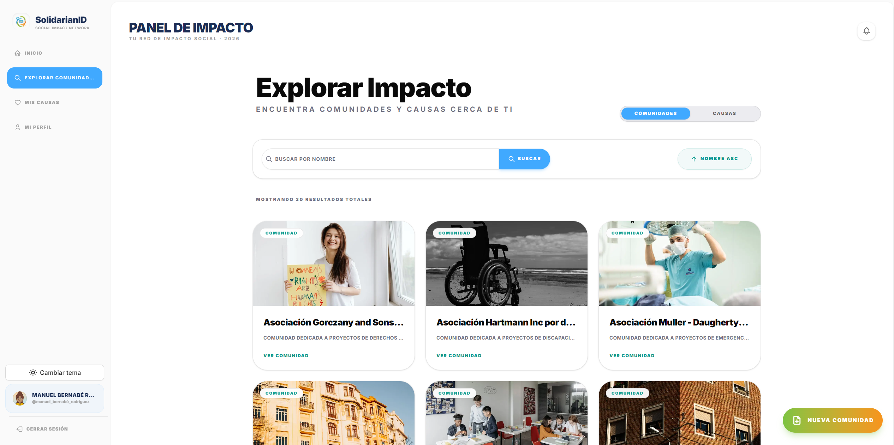
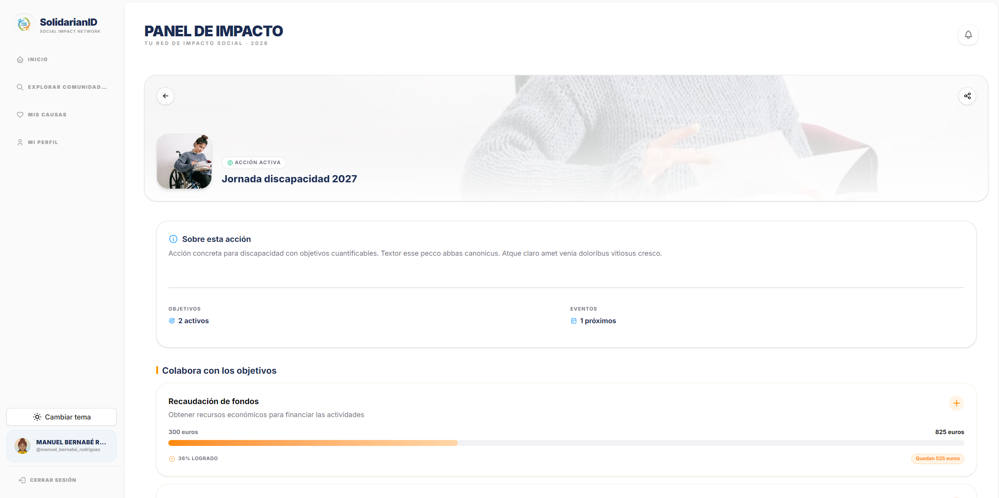
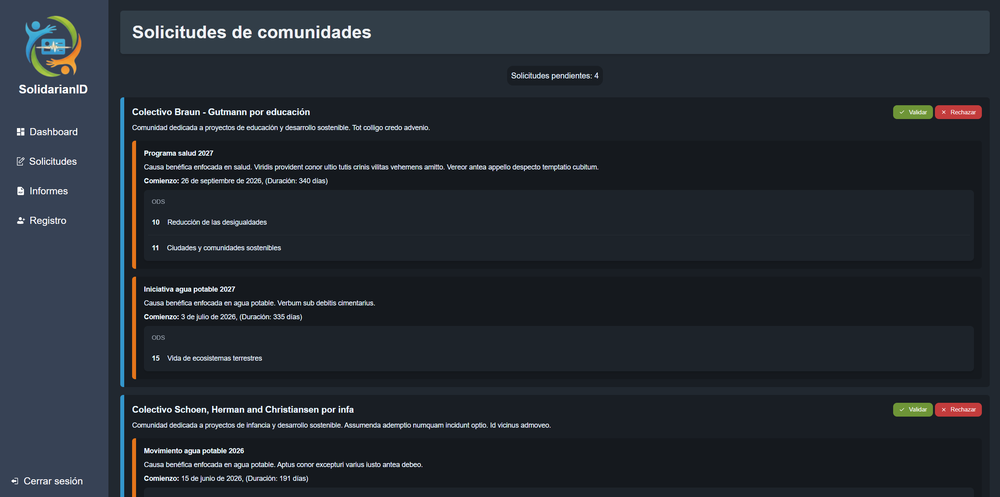
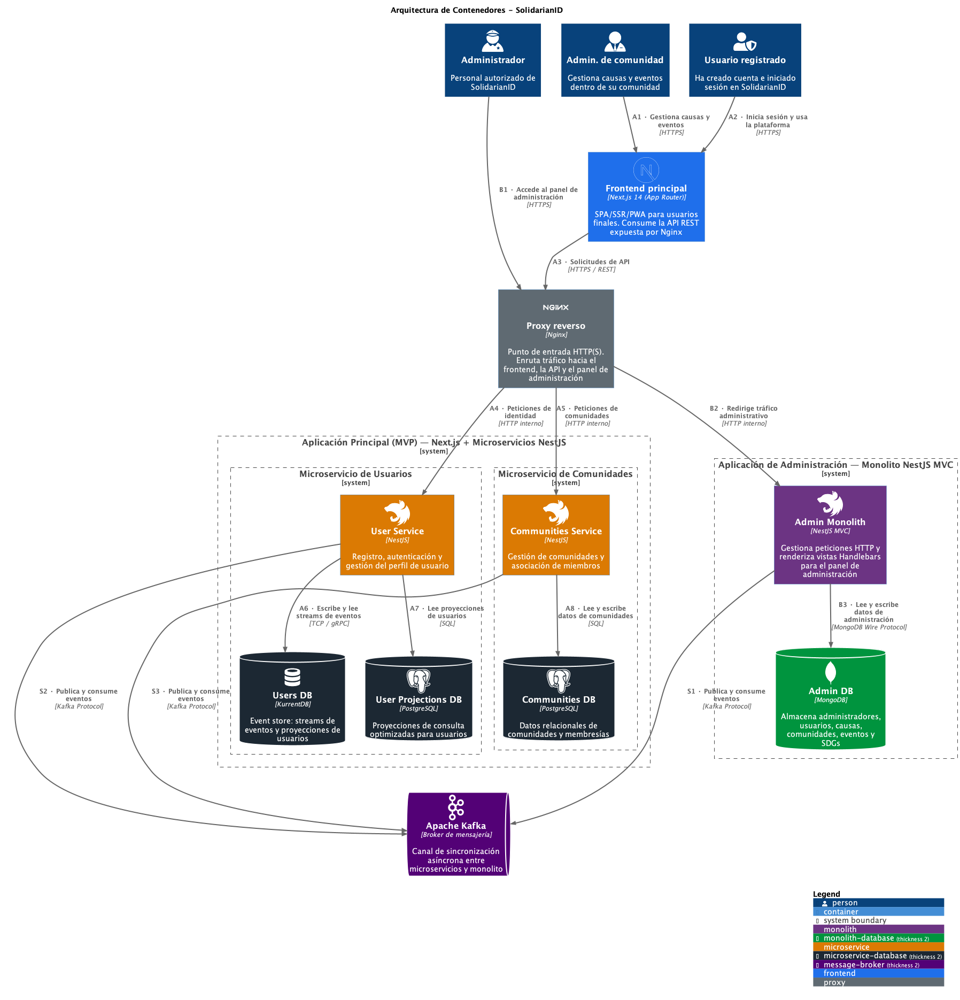
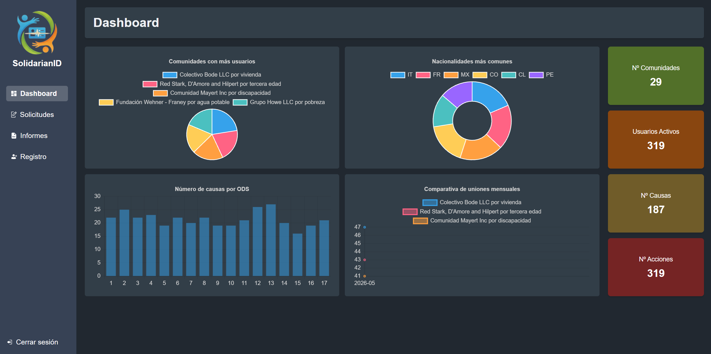

## Connecting people and social causes

SolidarianID is an academic project we developed as a team of five during the Master's in Software Engineering at the University of Murcia. It starts from a case study for the association “Voluntarios Sin Fronteras”: creating a platform to discover social initiatives, organise communities and coordinate their members' participation.

The challenge was to connect an interest in a cause with practical ways to contribute. The platform brings together initiative discovery, members' proposals, the goals they want to achieve and events they can attend. A separate admin application supports proposal reviews and provides an overview of system activity.

Digital identity gives the project its name. Each person has a unique identifier linking them to their profile, the communities they belong to and their participation in causes and actions.

<figure>

<figcaption>Exploring communities with search, sorting and access to their initiatives.</figcaption>
</figure>

## From a community to an action

Activity is organised into three levels: a **community** brings together people with shared interests, a **cause** sets out an initiative and an **action** defines how to carry it out. Causes are linked to the Sustainable Development Goals (SDGs), which also serve as filters when exploring initiatives.

<ol class="case-study-flow" aria-label="How a social initiative is organised">
  <li><strong>Community</strong>People with shared interests</li>
  <li><strong>Cause</strong>Initiative linked to the SDGs</li>
  <li><strong>Action</strong>A concrete project to contribute to</li>
  <li><strong>Goals and events</strong>Targets and activities to take part in</li>
</ol>

For example, a community focused on education could support a cause to improve access to school supplies. One action could be a collection campaign, with a target of 200 notebooks and an event to hand them over. This example illustrates how the model connects a broad intention with a measurable goal and an activity at a specific time and place.

People can search for initiatives, join communities and follow causes through the application. Their favourites bring these connections together so they can return to them. Within an action, they can record contributions towards goals and register for events; contributions are recorded as quantities that advance a target.

<figure>

<figcaption>Action details showing goals, events and progress from recorded contributions.</figcaption>
</figure>

## Proposing and reviewing initiatives

Creating communities, causes and actions follows a **request and approval workflow**. The backend checks permissions before accepting a proposal; for example, proposing causes or actions within a community requires being its creator or an administrator.

This workflow connects the user application with the admin panel:

1. **Proposal:** a person submits a request, and the communities service stores it as pending.
2. **Review:** the service publishes an event to Kafka, and the admin application adds the proposal to its panel.
3. **Decision:** an administrator accepts or rejects the request, providing a reason for rejection.
4. **Publication and notification:** the decision returns through Kafka to the communities service, which updates the request, creates the initiative if approved and generates a notification for the applicant.

<figure>

<figcaption>Reviewing community requests and their causes before approving publication.</figcaption>
</figure>

People can check the status of their proposals under “My requests”. GraphQL subscriptions deliver changes while the application is open, and push notifications can provide browser alerts, depending on permissions and browser support.

As each component processes events independently, there may be a short delay before a decision appears in the application. This is **eventual consistency**: services update their data as they receive changes.

## Two microservices and an admin application

**Next.js and React provide the user experience; NestJS organises the backend.** The main backend is split into two microservices: users and communities. Causes, actions and events belong to the communities service. Administration combines its backend and web views in a separate application.

| Component           | Responsibility                                                           |
| ------------------- | ------------------------------------------------------------------------ |
| User application    | Registration, profiles, exploration, participation and request tracking. |
| Users service       | Identity, authentication, profiles and preferences.                      |
| Communities service | Communities, causes, actions, goals, events and requests.                |
| Admin application   | Proposal reviews, user information, metrics and reports.                 |

Nginx acts as the entry gateway: it routes requests to the appropriate service, exposes GraphQL access and supports WebSocket connections. The backend is organised as a monorepo with shared libraries for contracts, security, messaging and domain concepts.

Communication combines several mechanisms according to the operation. **REST and GraphQL** handle application queries and operations; **Kafka** distributes business events, such as user changes and request decisions; and **gRPC** lets the admin application query statistics from the communities service through a typed contract.

This distribution requires coordinating information across applications. For example, a profile change is published as an event to update the user data needed by communities and administration.

<figure>

<figcaption>MVP container diagram: applications, services, storage and communication through events.</figcaption>
</figure>

## Business rules and backend organisation

The backend applies ideas from **Domain-Driven Design (DDD), hexagonal architecture and Clean Architecture** to separate product rules from the tools that execute them. The domain contains entities and validation rules; the application layer coordinates use cases; and infrastructure connects databases, APIs and messaging.

An action, for example, groups its goals and events. Its rules prevent duplicate registrations, reject participation in events that have already taken place and stop contributions from exceeding a goal's remaining target. Value objects validate concepts such as identifiers, quantities and dates.

Use cases work with repository contracts, and NestJS connects their implementations through dependency injection. This allows participation logic to be expressed without depending directly on TypeORM, MongoDB or Kafka. Entry points validate incoming data, while authorisation policies check the user's relationship with the resource.

The users service handles access with bcrypt-protected passwords and JWTs delivered in HttpOnly cookies. It separates the access token from refresh sessions, which are stored in PostgreSQL with a hash of the refresh token and its revocation status. It also supports Google sign-in through OAuth 2.0.

## Event Sourcing and persistence

One of the project's distinctive decisions is **Event Sourcing in the users service**. KurrentDB stores a sequence of facts for each user, such as their creation or changes to their name, location and preferences. Replaying these events in order reconstructs the user's state.

To search by username or phone number, the service maintains a **projection in PostgreSQL**: a query model updated from events. The process saves its last processed position so it can resume from there.

Separating the write history from the search model applies **CQRS** in this part of the system. Kafka and KurrentDB serve different purposes: Kafka communicates changes between applications, while KurrentDB retains the events used to reconstruct users.

The rest of the persistence is suited to each component's needs:

- **PostgreSQL** stores the relationships between communities, members, causes, actions and participation, with the users service's projection and sessions in a separate logical database.
- **MongoDB** stores administrative data, requests and the user representations used by the panel.
- **IndexedDB**, through Dexie, stores local notifications in the browser.

Each application queries the data it needs for its routine operations. Keeping these representations synchronised through events introduces challenges around failure recovery and handling repeated messages.

## A web experience with PWA capabilities

The user application uses **Next.js, React and TypeScript**, with App Router organising public pages, authentication and application screens. It combines server components to prepare content with client components for forms and interaction.

Tailwind CSS and components based on shadcn/ui and Base UI keep the interface consistent. React Hook Form and Zod handle forms and validation. After registering, people can set preferences such as the SDGs and cause categories they are interested in.

Redux Toolkit maintains authentication state, Apollo Client manages GraphQL, its cache and subscriptions, and Axios centralises REST calls and session recovery. Integrations are grouped by feature to share data access and behaviour across screens.

The manifest and service worker, managed with Serwist, allow the website to be installed as a **PWA** in compatible browsers. The application includes caching strategies, a fallback page for offline navigation and push notification handling. Operations such as submitting requests or recording contributions require a connection to the backend.

## Administration, metrics and reports

The admin panel uses **NestJS with server-rendered Handlebars views** and HTTP sessions to identify administrators. It supports reviewing proposals for communities, causes and actions, and consulting user information.

The dashboard brings together totals for users and approved initiatives, causes by SDG, users by country, and statistics on communities and new memberships. Chart.js displays the graphs using information from MongoDB and gRPC queries to the communities service.

<figure>

<figcaption>Activity indicators and charts in the admin panel, using demonstration data.</figcaption>
</figure>

Report generation with PDFKit produces user documents containing personal details, location and associated communities.

## Testing and automation

The project addresses quality at several levels: **Jest** for services and business rules, **Supertest** for endpoints and **Testcontainers** for integration tests with real dependencies in temporary containers. These include communication between users and communities through Kafka.

The admin application includes UI scenarios with Cypress. Stryker is configured to apply mutation testing to selected parts of the user model and service, and to value objects: it introduces changes to the code to check whether the tests detect incorrect behaviour.

GitHub Actions defines continuous integration workflows for frontend and backend, with formatting, lint and build checks. The backend adds tests with coverage and SonarQube analysis; the frontend includes type checking.

Docker Compose describes the local environment with databases, Kafka, Nginx and the backend applications. The repository also includes a manually triggered deployment workflow using Docker Hub and AWS CloudFormation, EC2 and Systems Manager. The infrastructure template needs updating to include KurrentDB and the frontend as a service and cover the full current application stack.

Working as a team allowed us to connect modelling, interface, data and automation decisions within a single product. The proposal workflow brings this experience together: it starts in a form, passes through permissions and business rules, reaches another application and returns to the user through events and notifications.

## Technologies and libraries

| Technology                                               | Role in the project                                                    |
| -------------------------------------------------------- | ---------------------------------------------------------------------- |
| **TypeScript and Node.js**                               | Shared language and application runtime.                               |
| **Next.js and React**                                    | Navigation, rendering and interaction in the user application.         |
| **NestJS and Handlebars**                                | Backend services and admin panel views.                                |
| **Tailwind CSS, shadcn/ui and Base UI**                  | Responsive styles and interface components.                            |
| **React Hook Form and Zod**                              | Form management and validation.                                        |
| **Redux Toolkit, Apollo Client and Axios**               | Authentication state, GraphQL operations and REST calls.               |
| **Apache Kafka and gRPC**                                | Events between applications and internal queries with typed contracts. |
| **PostgreSQL, MongoDB and KurrentDB**                    | Relational data, administrative documents and user event history.      |
| **TypeORM and Mongoose**                                 | Data access and repository implementations for each storage system.    |
| **Serwist, Web Push and Dexie**                          | PWA capabilities, notifications and local storage.                     |
| **Chart.js and PDFKit**                                  | Dashboard charts and user report generation.                           |
| **Jest, Supertest, Testcontainers, Cypress and Stryker** | Business logic, API, integration, UI and mutation testing.             |
| **GitHub Actions and SonarQube**                         | Automated checks and quality analysis.                                 |
| **Docker Compose and Nginx**                             | Local runtime environment and entry gateway.                           |
| **AWS CloudFormation, EC2 and Systems Manager**          | Infrastructure definitions and deployment automation.                  |

